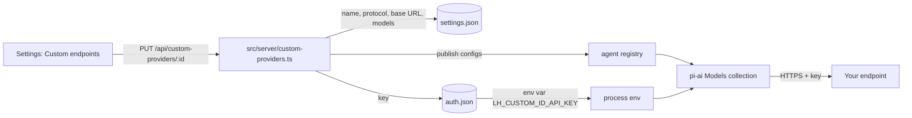

# Custom endpoints

A custom endpoint is a model server that LearnHarness reaches at a base URL you supply, instead of one of the built-in providers.
Use it for a university or company gateway, a self-hosted server, or any service that speaks one of the two supported protocols.
Every feature that calls a model (probing, teaching, practice, research, extraction, visuals) can run on a custom endpoint's models, because they all resolve models through the same engine.

## Supported protocols

| Protocol | LearnHarness sends chats to | Lists models at | Key header |
|---|---|---|---|
| Anthropic Messages | `{base URL}/v1/messages` | `{base URL}/v1/models` | `x-api-key` |
| OpenAI Chat Completions | `{base URL}/chat/completions` | `{base URL}/models` | `Authorization: Bearer` |

The two protocols are not interchangeable.
Pick the one your server documents; if it offers both, prefer the one that passes the connection test with tool calls (see [Troubleshooting](#troubleshooting)).
The OpenAI Responses API, Gemini and other protocols are not supported as custom endpoints.

## Set up an endpoint

1. Open **Settings → Providers** and find **Custom endpoints**.
   On first run, the setup dialog has an **Add a custom endpoint** link that opens the same form.
2. Click **+ Add custom endpoint** and fill in:
   - **Name**: any label, shown in the model picker.
   - **ID**: a short lowercase id such as `kmutt-sit`.
     It is suggested from the name and cannot change later, because your model choices are saved against it.
   - **Protocol**: Anthropic Messages or OpenAI Chat Completions.
   - **Base URL**: everything before the request path in the table above.
     LearnHarness adds that path itself, so do not include `/v1/messages` or `/chat/completions`.
   - **API key**: the token your provider issued.
3. Add models.
   Click **Fetch from /v1/models** (or `/models`) to list what the server offers, or type a model id and press **Add**.
4. Check each model's settings:
   - **Context** and **Max output** are token limits.
     Servers rarely report them, so new rows start at 128,000 and 16,384; lower them if your provider documents smaller limits.
   - **Thinking**: turn on for reasoning models so the thinking-level picker can request extended thinking.
   - **Images**: turn on only for models that accept image input.
     The vision slot (visual maker and PDF reader) needs at least one such model.
5. Click **Save**, then reopen the endpoint and use **Send a test request** to confirm the key and model work.
6. Pick the endpoint's models for your **strong**, **cheap** and **vision** slots in the model picker or the setup dialog.

## Example: KMUTT SIT Model API

| Field | Value |
|---|---|
| Name | KMUTT SIT |
| Protocol | Anthropic Messages |
| Base URL | `https://nrrai2-model.sit.kmutt.ac.th/api` |
| API key | a token from the SIT Model API console |

Get the token from the SIT Model API console and paste it into the API key field.
Do not paste it into chats, files in a repository, screenshots or issue reports.

As of October 2026 the gateway lists `minimax-m2.7`, `minimax-m3` and `minimax-m3.1-flash`.
A test on 26 October 2026 found:

- The Anthropic Messages protocol works for every listed model, including streaming, tool calls, thinking and prompt caching.
- The OpenAI Chat Completions path accepts the key but then answers `404 page not found` for every model, so do not choose that protocol for SIT.
- `minimax-m3` and `minimax-m3.1-flash` read images correctly; `minimax-m2.7` did not, so leave **Images** off for it.
- All three return thinking blocks, so turning **Thinking** on is appropriate.

The gateway does not publish context or output limits, so the defaults apply until you learn the real ones.

## How keys are handled

- The key is stored in the app's `auth.json` (file mode 0600) under the environment variable name `LH_CUSTOM_<ID>_API_KEY`, for example `LH_CUSTOM_KMUTT_SIT_API_KEY`.
  The endpoint's other settings live in `settings.json`, which never contains the key.
- The browser never receives the key back.
  The settings page shows only its last four characters.
- A real environment variable with that name takes precedence over the saved key, the same rule as built-in providers.
- A key is only sent to the base URL it was saved with:
  - Changing an endpoint's base URL to a different host deletes the saved key unless you paste a new key in the same save.
  - **Fetch models** attaches the saved key only when the protocol and base URL match the saved endpoint, and refuses redirects when it does.
- Base URLs must use `https`; plain `http` is accepted only for `localhost`, `127.0.0.1` and `[::1]`.
  URLs with an embedded username or password, a query string or a fragment are rejected.
- Error messages are scanned for the key and redact it before they are shown.



## Troubleshooting

| Symptom | Likely cause | What to do |
|---|---|---|
| `HTTP 401: ... (check the API key)` | Wrong, expired or revoked key | Paste a fresh key from your provider's console and save. |
| `HTTP 404: model ... is not available` | The model id is not served by this endpoint | Fetch models again and use an id from the list. |
| `HTTP 404` with no message, or `404 page not found` | Wrong protocol or base URL | Check the base URL stops before the request path; try the other protocol if your server documents it. |
| `Could not reach host: ENOTFOUND` | Typo in the host, or DNS cannot resolve it | Check the URL; some campus gateways need a campus network or VPN. |
| `Could not reach host: ECONNREFUSED` or a timeout | Server down, firewall, or wrong port | Try again later, or from the network the provider requires. |
| `No model list at /v1/models` | The server has no list endpoint | Add model ids by hand. |
| `The model list needs an API key` | The list endpoint requires auth | Save the endpoint with its key first, then fetch. |
| The model is missing from the vision slot | **Images** is off for every model | Turn on **Images** for a model that accepts images. |
| The model picker does not show the endpoint | No key is saved | Open the endpoint and paste the key. |
| Chats fail but the test request works | Tool calls are not supported through this protocol | Try the other protocol, or ask your provider whether tool calling is enabled. |

You can also check an endpoint outside the app.
Keep the key in an environment variable so it never lands in your shell history or a file:

```sh
export SIT_API_KEY='paste-token-here'   # or set it in your shell profile
curl -s https://nrrai2-model.sit.kmutt.ac.th/api/v1/models
curl -s https://nrrai2-model.sit.kmutt.ac.th/api/v1/messages \
  -H "x-api-key: $SIT_API_KEY" -H "anthropic-version: 2023-06-01" -H "content-type: application/json" \
  -d '{"model":"minimax-m3","max_tokens":64,"messages":[{"role":"user","content":"Reply: ok"}]}'
```

## Manual integration test

The automated tests (`tests/custom-providers-*.test.ts*`) mock every HTTP call and need no real key.
To test against a real endpoint without writing the key to the repository:

1. Run the app against a throwaway data directory so nothing touches your real settings:
   `LH_DATA_DIR=$(mktemp -d) LH_AUTH_FILE=$(mktemp -d)/auth.json npm run dev`.
2. Add the endpoint in **Settings → Providers → Custom endpoints**, paste the key there, and use **Send a test request**.
3. Pick its models for the three slots and run a short lesson to exercise tool calls, thinking and streaming.
4. Delete the temporary directories when you are done.

Alternatively, export `LH_CUSTOM_KMUTT_SIT_API_KEY` in the shell that starts the app and leave the key field empty when you create the endpoint; the environment variable then supplies the key and nothing is saved to `auth.json`.
Never put a real key in `.env.local` files you might commit, in tests, or in fixtures.
